<!--
  Hello, source reader. 🐾
  You found the secret kennel. Every dog in here is a good dog,
  and the cat has already approved your pull request (she hasn't).
  Treat password: "boop".
-->

<div align="center">

<a href="https://pupmeow.in"></a>

<br/>


### The neighbourhood app for dog and cat families in Delhi NCR

Lost-pet alerts that reach your street in minutes. Adoption that is always free.<br/>
Playdates in your own park. Every vaccine date in one place. And Kaia, a friendly AI for pet questions.

<br/>

[](https://pupmeow.in)
[](https://www.instagram.com/pupmeow.in)
[](https://nextjs.org/)
[](https://supabase.com/)
[](https://pupmeow.in)


**[🌐 Open Pupmeow](https://pupmeow.in)** &nbsp;·&nbsp; **[📲 Get the app](https://pupmeow.in/get-app)** &nbsp;·&nbsp; **[🚨 Lost pets](https://pupmeow.in/lost)** &nbsp;·&nbsp; **[💛 Adopt](https://pupmeow.in/adopt)** &nbsp;·&nbsp; **[✉️ Say hi](mailto:pupmeow.team@gmail.com)**

<br/>

**Follow on Instagram:** [**instagram.com/pupmeow.in**](https://www.instagram.com/pupmeow.in) — lost-pet tips, reunions & community updates

</div>

<br/>

<p align="center">
  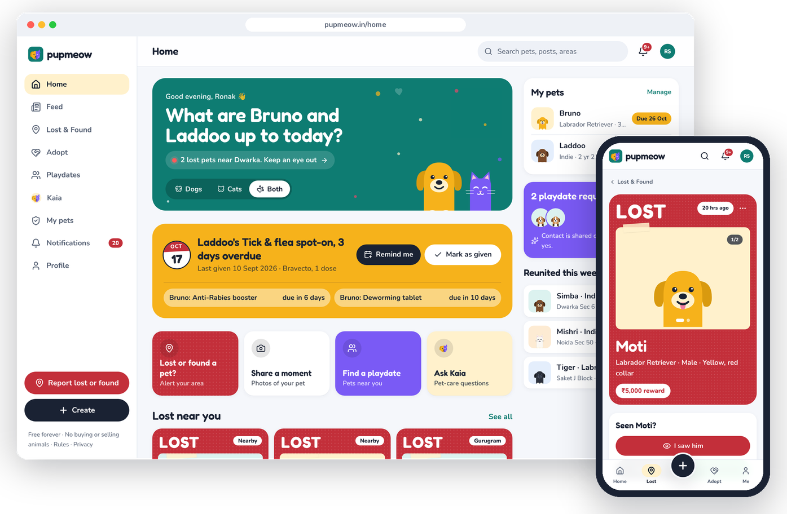
</p>

<p align="center"></p>

## 🐾 Why Pupmeow

When a pet goes missing in Delhi, the alert gets lost across fifty WhatsApp groups. Adoption happens in Instagram DMs where someone always asks for a "transport fee". Vaccine dates live on a paper card in a drawer.

Pupmeow puts the pet, the owner and the neighbourhood in one place, and keeps every conversation on WhatsApp, where Delhi already talks.

<table>
<tr>
<td align="center" width="25%">🆓<br/><b>Free forever</b><br/><sub>No ads on lost-pet alerts</sub></td>
<td align="center" width="25%">🚫💸<br/><b>No selling animals</b><br/><sub>Priced listings get removed</sub></td>
<td align="center" width="25%">🔒<br/><b>Private by default</b><br/><sub>Your number, only when you say so</sub></td>
<td align="center" width="25%">📸<br/><b>Real pets</b><br/><sub>Your photos; mascots fill the gaps</sub></td>
</tr>
</table>

## ✨ What's inside

<table>
<tr>
<td width="50%"></td>
<td width="50%"></td>
</tr>
<tr>
<td width="50%"></td>
<td width="50%"></td>
</tr>
<tr>
<td width="50%"></td>
<td width="50%"></td>
</tr>
</table>

<p align="center">
  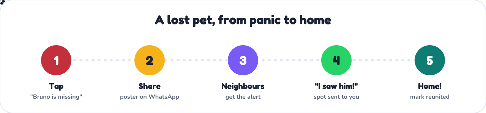
</p>

<details>
<summary><b>🔎 Every little thing it does</b></summary>

<br/>

| | Feature | What you can do |
|:---:|---|---|
| 🏠 | **Home** | See your pets' next care date, lost pets near you, playdate requests and new posts |
| 🚨 | **Lost & Found** | Report from your pet's page, print an A4 poster with QR, share a ready-made WhatsApp image, see the map |
| 👀 | **"I saw him / her"** | Notify the owner in the app with where and when; then continue on WhatsApp if you choose |
| 🎉 | **Reunited** | Mark a pet home, stop the alert and celebrate with everyone who helped |
| 💛 | **Adopt** | Free listings from families and NGOs, filters for age, vaccines and sterilisation |
| 🤝 | **Playdates** | Request, accept, then the number unlocks and you add the plan to your calendar |
| 💉 | **Pet health** | Vaccines, tick, deworming, vet visits and weight, with a chart |
| 📅 | **Reminders** | Google Calendar or an .ics file for any phone, plus "Mark as given" for the next date |
| 🤖 | **Kaia** | Pet-care chat with an emergency banner when something sounds urgent (not a vet) |
| 📣 | **Feed** | Photos, hashtags, likes, comments, follows and search |
| 🌙 | **Dark mode** | Light, dark or match your phone |
| 📱 | **Install it** | Add to home screen, with an offline page when the network drops |

</details>

## 📱 Made for your phone

<p align="center">
  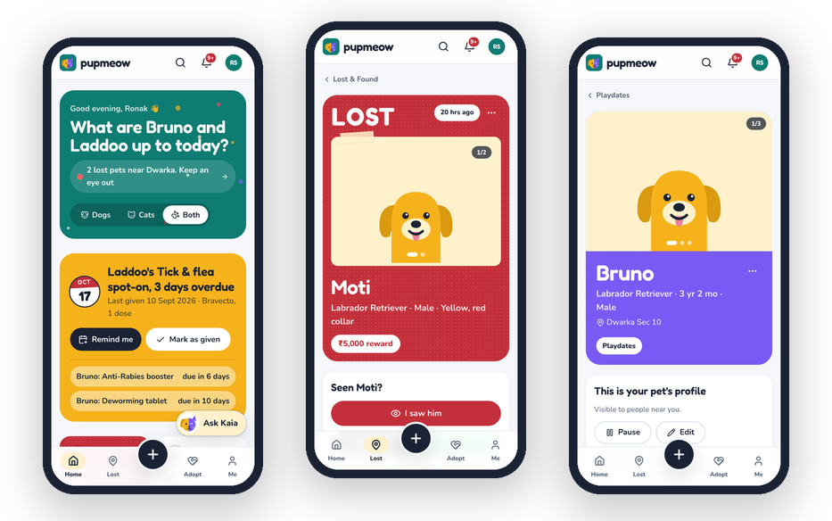
</p>

<details>
<summary><b>🖼️ More screens</b></summary>

<br/>

<table>
<tr>
<td width="50%">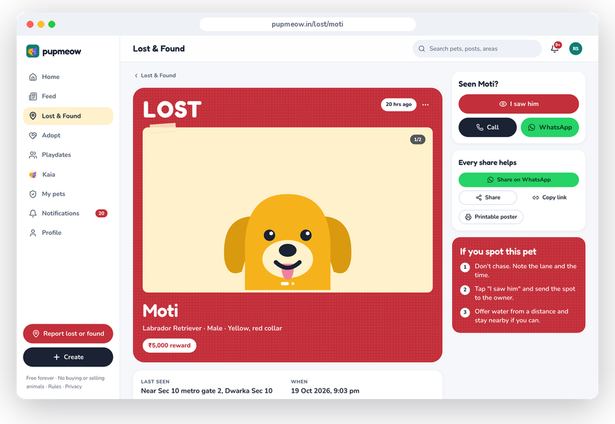<p align="center"><sub>A lost pet, poster-style</sub></p></td>
<td width="50%">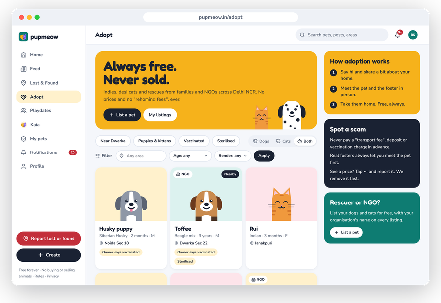<p align="center"><sub>Free adoption</sub></p></td>
</tr>
<tr>
<td width="50%">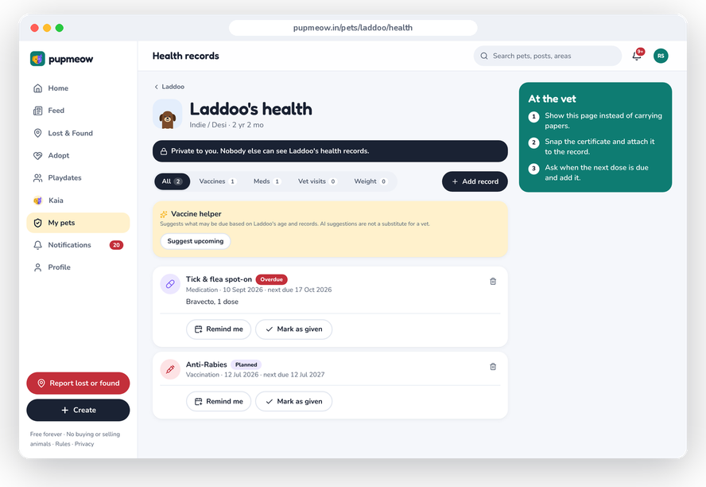<p align="center"><sub>Health records and reminders</sub></p></td>
<td width="50%">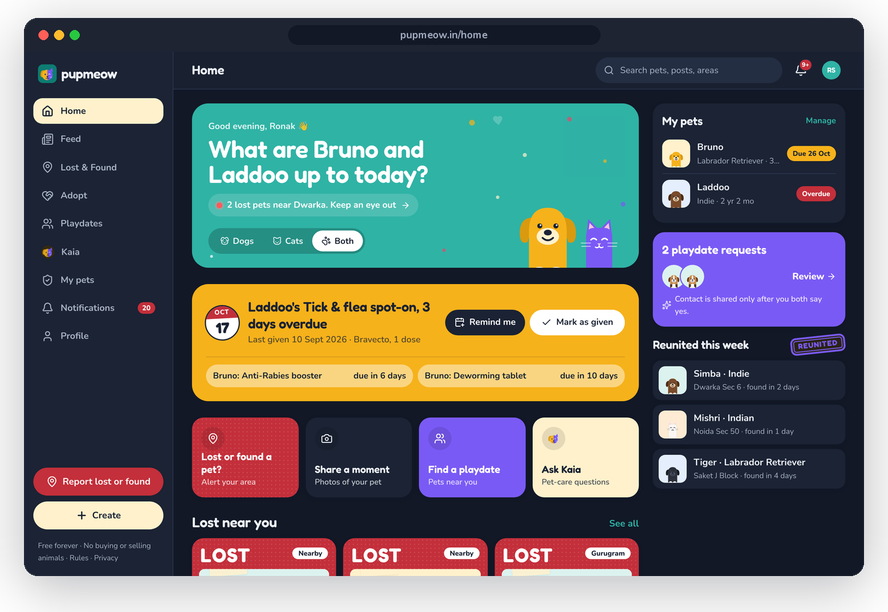<p align="center"><sub>Dark mode, for 2 am walks</sub></p></td>
</tr>
</table>

<sub>Screens use sample data, with Pupmeow mascots standing in for real pet photos.</sub>

</details>

<p align="center"></p>

## 🚀 Run it on your computer

You need **Node.js 20+** and a free **[Supabase](https://supabase.com)** project.

```bash
git clone https://github.com/Pragylucky/PupMeow.git
cd PupMeow
npm install
cp .env.example .env.local   # add your Supabase keys
npm run dev                  # open http://localhost:3000
```

Then run the SQL files in `supabase/migrations/` **in filename order** (Supabase SQL editor, or `supabase db push`). If photo buckets don't appear, run `npm run setup:storage`.

<details>
<summary><b>⚙️ Environment variables</b></summary>

<br/>

| Variable | What it's for |
|---|---|
| `NEXT_PUBLIC_SUPABASE_URL` | Your Supabase project URL |
| `NEXT_PUBLIC_SUPABASE_ANON_KEY` | Public key (row-level security protects the data) |
| `SUPABASE_SERVICE_ROLE_KEY` | **Secret.** Server only, never in the browser |
| `NEXT_PUBLIC_SITE_URL` | `http://localhost:3000` or `https://pupmeow.in` |
| `NEXT_PUBLIC_INSTAGRAM_URL` | Optional; defaults to [instagram.com/pupmeow.in](https://www.instagram.com/pupmeow.in) (header & footer in the app) |
| `AI_PROVIDER` | `google` or `openai`. Leave empty to hide Kaia |
| `GOOGLE_GENERATIVE_AI_API_KEY` / `OPENAI_API_KEY` | Only when AI is on |

🔐 Never commit `.env.local`. It's already in `.gitignore`.

</details>

<details>
<summary><b>🔑 Sign-in setup (Google only)</b></summary>

<br/>

1. **Supabase → Authentication → Providers:** **Google on**, **Email off** (matches the app).
2. **URL configuration:** Site URL `https://pupmeow.in` (or `http://localhost:3000` locally). Redirect URLs: `http://localhost:3000/**`, `https://pupmeow.in/**`, `https://www.pupmeow.in/**`, and optionally `https://pupmeow.vercel.app/**` for old links.
3. **Google Cloud:** web OAuth client → redirect `https://<project-ref>.supabase.co/auth/v1/callback` → paste client ID/secret into Supabase → Google. **Publish** the consent screen before public launch.

</details>

<details>
<summary><b>☁️ Put it online</b></summary>

<br/>

**Live site:** [**pupmeow.in**](https://pupmeow.in) — set `NEXT_PUBLIC_SITE_URL` to `https://pupmeow.in` on Vercel (Production + Preview) and in Supabase Auth. Redeploy after changing env vars.

Host on **[Vercel](https://vercel.com)** (Mumbai **bom1** region), run Supabase migrations on production, and see **[docs/LAUNCH_HANDOFF.md](./docs/LAUNCH_HANDOFF.md)** for the launch checklist.

**Android app:** The site is a PWA at **pupmeow.in**. Users can **Install app** from Chrome, or you can wrap the same URL with **[PWABuilder](https://www.pwabuilder.com)** into an APK/AAB for testers and Play Store — full steps in **[docs/ANDROID_APP.md](./docs/ANDROID_APP.md)** and **[pupmeow.in/get-app](https://pupmeow.in/get-app)**.

</details>

<details>
<summary><b>🧰 Handy commands</b></summary>

<br/>

| Command | What it does |
|---|---|
| `npm run dev` | Start the app locally |
| `npm run build` · `npm start` | Production build and server |
| `npm test` | Unit tests (Vitest) |
| `npm run test:e2e` | Browser tests (Playwright) |
| `npm run preflight` | Type check, lint and build in one go |
| `npm run seed` · `npm run remove-seed` | Add or remove demo data |

</details>

## 🧱 Built with

<p align="center">
  <a href="https://skillicons.dev"></a>
</p>

<p align="center"><sub>Next.js 15 · React 19 · TypeScript · Tailwind CSS 4 · Supabase (Postgres, Auth, Storage, Realtime) · AI SDK · Vercel</sub></p>

```text
src/app/              every page: home, feed, lost, adopt, match, pets, assistant…
src/components/       UI kit, features and the brand (logo, mascots, stamps)
src/lib/              Supabase, server actions, AI, calendar, validation
supabase/migrations/  database, run in filename order
docs/assets/          the animated pictures in this README
```

## 🗺️ What's next

- [x] Lost & Found with posters, sightings and reunions
- [x] Free adoption, playdates, pet health and Kaia
- [x] Redesigned web app with dark mode
- [x] **Live at [pupmeow.in](https://pupmeow.in)**
- [ ] 📲 **Android:** PWA install + [APK / Play steps](./docs/ANDROID_APP.md) · site page [**/get-app**](https://pupmeow.in/get-app)
- [ ] 🩺 Vets and groomers near you
- [ ] 🎪 Pet meetups and adoption camps
- [ ] 🏙️ More cities beyond Delhi NCR

## 💌 Help out

Found a bug, have an idea, or run a rescue that wants to list pets? **[Open an issue](https://github.com/Pragylucky/PupMeow/issues)**, write to **[pupmeow.team@gmail.com](mailto:pupmeow.team@gmail.com)**, or DM us on **[Instagram @pupmeow.in](https://www.instagram.com/pupmeow.in)**. Pull requests are welcome; small and friendly ones get merged fastest.

<details>
<summary>🦴 <i>Do not open this.</i></summary>

<br/>

```text
        / \__                      /\_/\
       (    @\___    you opened   ( o.o )
       /         O   it anyway.    > ^ <
      /   (_____/                 /     \
     /_____/   U    Good human.  (_______)
```

Here's your treat: 🦴🍪🐟. Share it with the nearest street dog.

</details>

<details>
<summary>🤔 <i>Is the logo a dog or a cat?</i></summary>

<br/>

Yes.

<sub>The left half is a marigold pup with a floppy ear. The right half is a violet cat mid-wink. They share one nose and refuse to discuss custody.</sub>

</details>

<br/>

<p align="center">
  
</p>

<div align="center">

**No buying or selling animals, ever.**

[Terms](https://pupmeow.in/terms) · [Privacy](https://pupmeow.in/privacy) · [Community rules](https://pupmeow.in/guidelines) · [Instagram](https://www.instagram.com/pupmeow.in)

<sub>© Pupmeow · Made with 🐾 in Delhi NCR · If you scrolled this far, go give your pet a treat.</sub>

</div>
