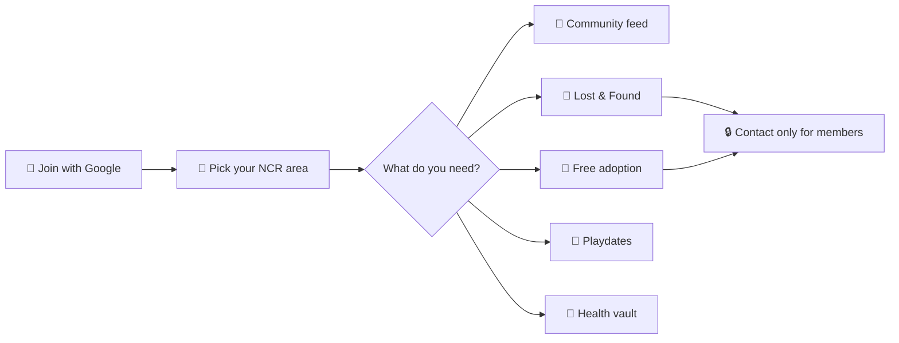

<div align="center">

[](https://pupmeow.in)


### Pet neighbours, from Dwarka to Noida.

**Free · mobile-first · Google sign-in** — feed, lost & found, adoption, playdates, health records, and optional **Kaia** (AI).

<br/>

[](https://pupmeow.in)
[](https://nextjs.org/)
[](https://supabase.com/)
[](https://www.typescriptlang.org/)
[](https://pupmeow.in)

<br/>

**[Join free](https://pupmeow.in/login)** · **[Lost pets](https://pupmeow.in/lost)** · **[Adopt](https://pupmeow.in/adopt)** · **[@pupmeow.in](https://www.instagram.com/pupmeow.in)** · **[pupmeow.team@gmail.com](mailto:pupmeow.team@gmail.com)**

</div>

---

## At a glance



| | |
|:---:|:---|
| 🐶🐱 | **Dogs & cats** — toggle species across the app |
| 🆓 | **Always free** — no listings with prices or fees |
| 🔐 | **Privacy-first contact** — Call / WhatsApp only after sign-in + safety sheet |
| 📱 | **PWA** — install to home screen, dark mode, offline fallback |
| 🛡️ | **Moderation** — reports, blocks, `/admin` for the team |

<details>
<summary><strong>📚 Docs & handoff</strong></summary>

| Doc | Use it for |
|-----|------------|
| [DEPLOY.md](./DEPLOY.md) | GitHub → Vercel → go live |
| [docs/LAUNCH_HANDOFF.md](./docs/LAUNCH_HANDOFF.md) | Full launch summary |
| `python3 scripts/generate-launch-handoff-pdf.py` | Local PDF from handoff MD (not in git) |
| [docs/LAUNCH_READINESS_AND_TESTING.md](./docs/LAUNCH_READINESS_AND_TESTING.md) | Tests, load checks, QA |
| [docs/STRESS_TEST_1000_FOR_LAUNCH.md](./docs/STRESS_TEST_1000_FOR_LAUNCH.md) | Big-spike expectations |
| [SECURITY.md](./SECURITY.md) | RLS, contact privacy |

</details>

---

## What you get

<table>
<tr>
<td width="50%" valign="top">

**Community**
- Nearby / city / following feed
- Photos, hashtags, @mentions, search
- Live notification bell (Realtime)

**Lost & Found**
- Public share pages + OG images
- Printable poster + QR
- “I saw” sighting → owner alert
- Reunited flow + happy stories

</td>
<td width="50%" valign="top">

**Adoption & match**
- Free adoption only (moderation blocks sales)
- Playdate / breeding profiles
- Contact revealed only after mutual accept

**Care & Kaia**
- Private health records + calendar export
- Optional AI assistant (daily cap, emergency banner)

**Safety**
- Report, block, admin queue + ban audit log

</td>
</tr>
</table>

**Not in v1:** native apps, in-app chat (use WhatsApp/phone), email login.

---

## Capacity (plain language)

| Scenario | Expectation |
|----------|-------------|
| Normal launch (hundreds of families over days) | ✅ Fine on Vercel + Supabase |
| ~50–100 people opening pages at once | ✅ Tested with caching; prod &gt; local `npm start` |
| Huge viral spike (500+ same second) | ⚠️ May slow; data still protected by RLS |

---

## Quick start

```bash
git clone https://github.com/Pragylucky/PupMeow.git
cd PupMeow
npm install
cp .env.example .env.local   # Supabase keys + optional AI
```

1. Run SQL in `supabase/migrations/` **in filename order** (SQL editor or `supabase db push`).
2. `npm run setup:storage` if buckets fail from SQL alone.
3. `npm run dev` → [http://localhost:3000](http://localhost:3000)

**Local auth:** Supabase → `http://localhost:3000/**` redirects · **Google on, Email off** · OAuth redirect = `https://<project-ref>.supabase.co/auth/v1/callback`.

<details>
<summary><strong>⚙️ Environment variables</strong></summary>

| Variable | Purpose |
|----------|---------|
| `NEXT_PUBLIC_SUPABASE_URL` | Supabase project URL |
| `NEXT_PUBLIC_SUPABASE_ANON_KEY` | Public anon key (RLS enforced) |
| `SUPABASE_SERVICE_ROLE_KEY` | **Secret** — server only |
| `NEXT_PUBLIC_SITE_URL` | `http://localhost:3000` or `https://pupmeow.in` |
| `NEXT_PUBLIC_INSTAGRAM_URL` | Optional; defaults to [@pupmeow.in](https://www.instagram.com/pupmeow.in) |
| `AI_PROVIDER` | `google` or `openai`; empty hides Kaia |
| `GOOGLE_GENERATIVE_AI_API_KEY` / `OPENAI_API_KEY` | When AI is on |
| `AI_ENABLED`, `AI_MODERATION_LLM`, `AI_LOST_MATCHING` | Cost toggles — see `.env.example` |

Never commit `.env.local`.

</details>

<details>
<summary><strong>☁️ Supabase production</strong></summary>

- **Google on · Email off** (matches the app)
- **Site URL:** `https://pupmeow.in`
- **Redirect URLs:** `https://pupmeow.in/**` and preview URLs per [DEPLOY.md](./DEPLOY.md)
- **Realtime:** `notifications` in `supabase_realtime`
- **Latest migration:** `20261011001500_admin_audit_sightings.sql`

</details>

<details>
<summary><strong>🔑 Google OAuth</strong></summary>

1. [Google Cloud Console](https://console.cloud.google.com) → consent screen → **Publish** before public launch.
2. Web client → origins: `http://localhost:3000`, `https://pupmeow.in` · redirect: Supabase callback.
3. Client ID + secret → Supabase → Authentication → Google.

</details>

<details>
<summary><strong>👑 Admin</strong></summary>

After Google sign-in:

```sql
update public.profiles set role = 'admin'
where id = (select id from auth.users where email = 'you@example.com');
```

Open **`/admin`**. Role lives in `profiles.role`, not the Supabase dashboard.

</details>

<details>
<summary><strong>🚀 Deploy on Vercel</strong></summary>

1. Import repo → env from `.env.example`
2. Region **Mumbai (bom1)** when available
3. Update Supabase + Google for production domain
4. Run migrations on **production** DB
5. `npm run remove-seed` if demo seed was ever run on prod

→ [DEPLOY.md](./DEPLOY.md)

</details>

---

## Scripts & tests

| Command | What it does |
|---------|----------------|
| `npm run dev` | Development server |
| `npm run build` / `npm start` | Production build / server |
| `npm run preflight` | typecheck + lint + build |
| `npm test` | Vitest |
| `npm run playwright:install` | Browsers (Mac TLS fix) |
| `npm run test:e2e` | Smoke: landing, login, `/lost`, auth |
| `npm run load-test:100` | 50 + 100 concurrent HTTP |
| `npm run seed` / `npm run remove-seed` | Demo data / wipe `@seed.pupmeow.test` |
| `python3 scripts/generate-launch-handoff-pdf.py` | Regenerate launch PDF |

---

## Launch smoke test (~15 min on your phone)

- [ ] Landing, `/lost`, `/adopt` logged out
- [ ] **Continue with Google** → onboarding → home
- [ ] Lost post → share → safety sheet → WhatsApp
- [ ] Second account: “I saw” → owner notification
- [ ] Pet health → **Add to calendar**
- [ ] `/admin` after SQL + migration

Full checklist → [docs/LAUNCH_READINESS_AND_TESTING.md](./docs/LAUNCH_READINESS_AND_TESTING.md)

---

## Project structure

```
src/app/              Routes (feed, lost, adopt, match, pets, admin, marketing…)
src/components/       UI, features, layout, brand (LogoMark, PetArt, stamps)
src/lib/              Supabase, actions, AI, cache, validations
supabase/migrations/  SQL — run in order
tests/                Vitest + Playwright
docs/assets/          README hero & logo SVGs (animated)
```

---

## Roadmap

1. Native apps (Expo) + push  
2. Vet / groomer directory  
3. Events & meetups  
4. In-app messaging  
5. More cities, species, Hindi UI  

---

<div align="center">

**Terms & privacy:** [`/terms`](https://pupmeow.in/terms) · [`/privacy`](https://pupmeow.in/privacy)  
*Terms are marked draft for review — legal sign-off before a big campaign.*

<br/>


<br/>

**© Pupmeow** — Made in Delhi · **No buying or selling animals, ever.**

</div>
